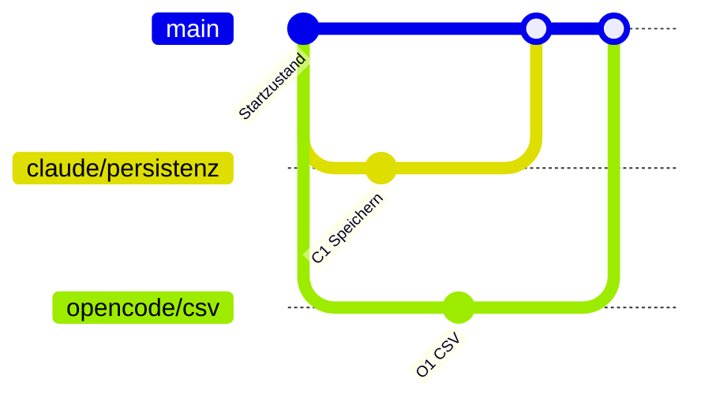
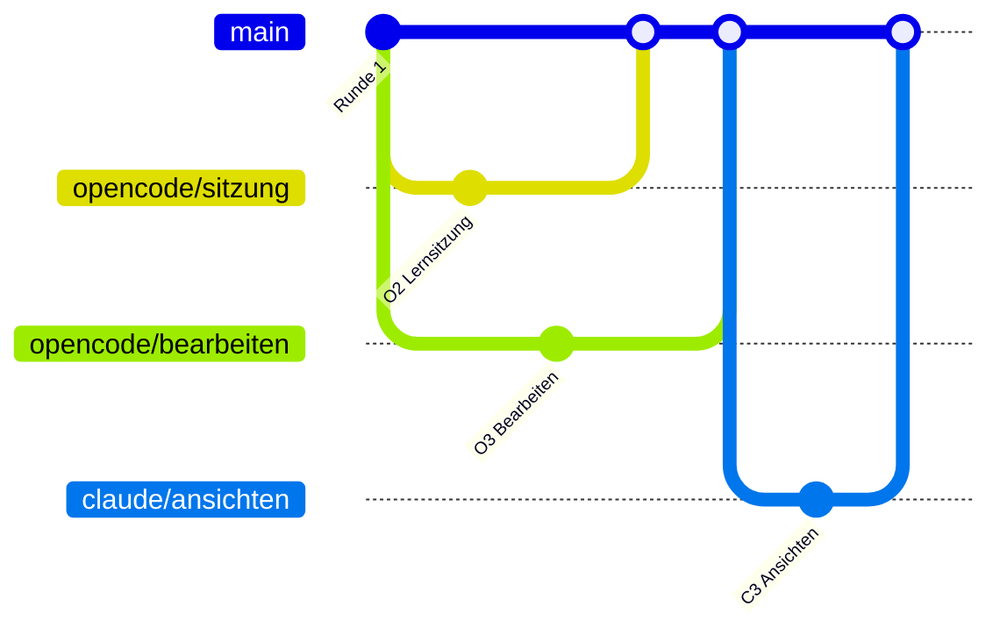
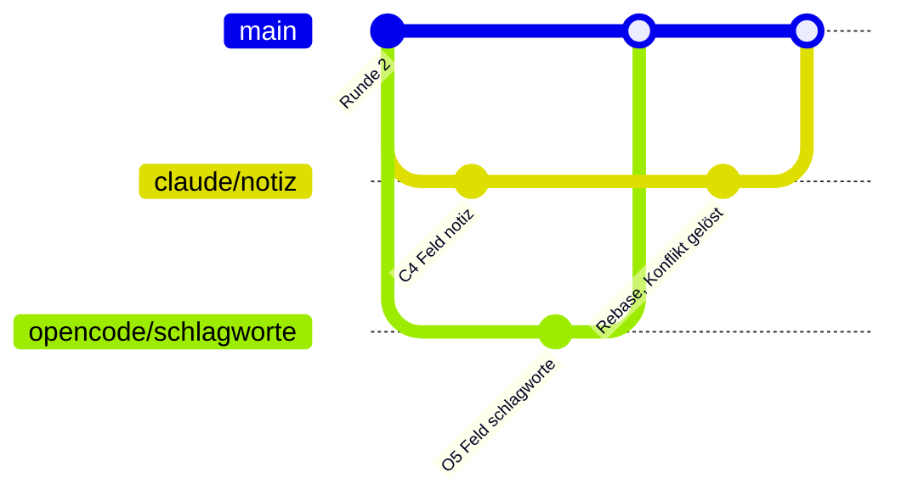
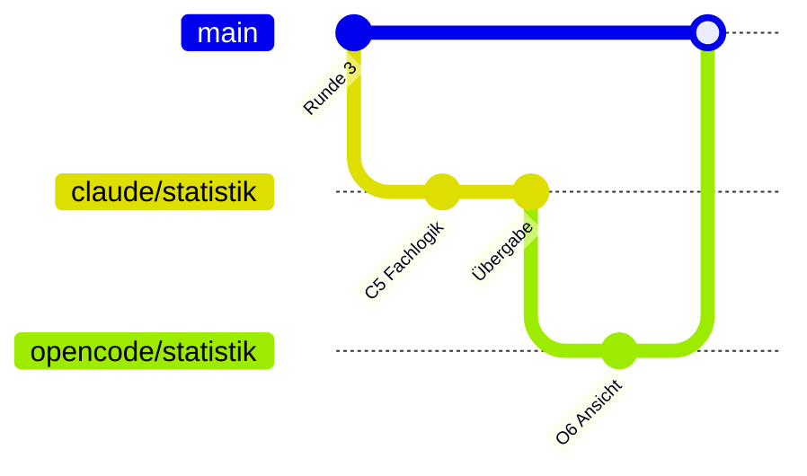

# Arbeitsblatt: Lernkarten mit zwei Coding-Agenten

Dieses Arbeitsblatt führt in vier Runden durch die Weiterentwicklung der Lernkarten-App. Im Mittelpunkt steht das Zusammenspiel: Claude Code im Pro-Plan und opencode mit freien Modellen arbeiten in herdr nebeneinander, beauftragen und prüfen sich gegenseitig, und Konflikte werden sichtbar erkannt und gelöst.

Jeder Schritt ist gleich aufgebaut: was zu tun ist, mit welchen Tasten oder Befehlen, was dabei zu sehen sein muss und was zu tun ist, wenn es anders aussieht. Kästen mit „Vorführung“ sagen, worauf Sie das Publikum hinweisen.

Grundlagen: [[INSTALLATION]], [[ENTWICKLUNGSLEITFADEN]], [[GITHUB]]. Tasten: [[spickzettel/herdr]], [[spickzettel/claude-code]], [[spickzettel/opencode]].

> [!info] Stand
> Modellnamen und herdr-Tasten entsprechen dem 12.11.2026 (herdr 0.9.5). Die freien Modelle in opencode sind befristet: vor jeder Vorführung mit `opencode models` prüfen. Alle herdr-Tasten beginnen mit dem Präfix `ctrl+b`; „`ctrl+b`, `w`“ heißt: erst `ctrl+b`, loslassen, dann `w`.

## 0. Was die Vorführung zeigt

| Runde | Muster | Das zeigt das Zusammenspiel |
| --- | --- | --- |
| 1 Parallel | Beide arbeiten gleichzeitig an getrennten Dateien | Zwei Agenten, zwei Worktrees, eine Seitenleiste; Claude prüft opencode und schickt die Befunde selbst zurück |
| 2 Zuarbeit und Integration | opencode liefert getestete Fachlogik, Claude baut die Oberfläche darauf | Arbeitsteilung nach Stärke und Kosten; Prüfung in beide Richtungen |
| 3 Gewollter Konflikt | Beide ändern dieselbe Stelle | Die Konfliktprüfung schlägt an, Claude löst per Rebase, opencode liest gegen |
| 4 Staffel | Claude beginnt, opencode übernimmt | Übergabe über eine Datei im Branch, wenn das Kontingent knapp wird |

Die Rollen in herdr während der ganzen Vorführung:

| Agent | Workspace | Rolle |
| --- | --- | --- |
| `leitstand` | `lernkarten` auf `main` | Claude Code ohne eigenen Branch: prüft, beauftragt, deutet die Konfliktprüfung |
| `claude-<thema>` | `claude/<thema>` | Claude Code, setzt eine Aufgabe um |
| `opencode-<thema>` | `opencode/<thema>` | opencode, setzt eine Aufgabe um |
| `opencode-pruefer` | `lernkarten` auf `main` | opencode ohne eigenen Branch: Zweitmeinung zu Claudes Arbeit |

Die Namen vergeben Sie mit `herdr agent rename`. Über sie schicken sich die Agenten Aufträge, und das Publikum sieht in der Seitenleiste, wer gerade arbeitet.

## 1. Projektwerte

| Wert | Festlegung |
| --- | --- |
| Projektname und Ordner | `lernkarten` |
| App-Kennung | `de.metarow.lernkarten` |
| Technik | Tauri 2, Vue 3, TypeScript, Vite, Vitest |
| Mindestversionen | Node.js 22.12+, 24 oder ab 26; Rust ab 1.90; Git ab 2.38 |
| Fenster | 900 × 640, Titel „Lernkarten“ |
| Entwicklungsport | 1420 |
| Lernverfahren | Lernkartei nach Leitner mit 5 Fächern |
| Wiederholungsintervalle | Fach 1: 1 Tag, Fach 2: 2 Tage, Fach 3: 5 Tage, Fach 4: 10 Tage, Fach 5: 30 Tage |
| Bewertung | gewusst: ein Fach weiter (höchstens Fach 5); nicht gewusst: zurück in Fach 1 |
| Datendatei | `lernkarten.json`, Formatversion 1 |
| Ort der Datendatei unter Windows | `%APPDATA%\de.metarow.lernkarten\lernkarten.json` |
| Ort der Datendatei unter Linux | `~/.local/share/de.metarow.lernkarten/lernkarten.json` |
| Datumsformat | ISO `JJJJ-MM-TT` |
| Integrationsbranch | `main` |
| Agenten-Branches | `claude/<thema>` und `opencode/<thema>` |
| Worktree-Ablage in herdr | `~/Projects/.worktrees/lernkarten/<branch-slug>` |
| Worktree-Ablage ohne herdr | `../lernkarten.worktrees/<branch-slug>` |
| Übergabedatei | `uebergaben/<branch mit - statt />.md` |
| Konfliktprüfung | `nu scripts/konflikt-check.nu`, in herdr `ctrl+b`, `alt+k` |
| Startzustände der Runden | Tags `runde-2`, `runde-3`, `runde-4`, `ende`; `nu scripts/runde.nu`, Abschnitt 9.1 |

Der Startzustand zeigt zwei Beispielstapel mit der Zahl fälliger Karten. Gespeichert, gelernt und bearbeitet wird noch nicht; das entsteht in den Runden.

## 2. Arbeitsteilung und Modellwahl

Die beiden Agenten sind ungleich: Claude Code ist stark, aber das Kontingent des Pro-Plans ist knapp. Die freien Modelle in opencode kosten nichts, sind aber schwächer. Daraus folgt die Arbeitsteilung.

| | Claude Code (Pro-Plan) | opencode (freie Modelle) |
| --- | --- | --- |
| Engpass | Kontingent | Urteilsvermögen |
| Übernimmt | Entwurf, Oberfläche, geteilte Dateien, Gegenlesen, Konfliktlösung | Fachlogik mit Tests nach genauer Vorgabe, mechanische Änderungen, Zweitmeinung |
| Aufträge | knapp, mit Ziel und Grenzen | ausführlich, mit Funktionsnamen, Dateiliste, Testfällen und vorgegebenen Testtexten |
| Ergebnis geht | nach Zweitmeinung durch opencode zum Zusammenführen | immer erst durch `/gegenlesen` von Claude Code |

### Claude Code im Pro-Plan

Sitzungslimit über fünf Stunden und Wochenlimit gelten gemeinsam für Claude Code und den Chat auf claude.ai.

| Modell und Aufwand | So einstellen | Einsatz |
| --- | --- | --- |
| `sonnet`, Aufwand `high`, Planmodus | `/effort high`, dann `shift+tab` bis zum Planmodus | C1: Entwurf über mehrere Dateien |
| `sonnet`, Aufwand `medium` | Vorgabe aus `.claude/settings.json` | C3, C5, Rebase in Runde 3 |
| `sonnet`, Aufwand `high` | `/effort high` | Leitstand: Gegenlesen |
| `haiku` | `claude --model haiku` | C4: kleine, mechanische Änderung |

Der Planmodus: Claude liest und plant nur, ändert nichts, und legt einen Plan zur Freigabe vor. Einen falschen Ansatz im Plan zu korrigieren kostet wenige Sätze, bereits geschriebenen Code zu verwerfen kostet Kontingent. `shift+tab` schaltet reihum zwischen Manuell, Änderungen annehmen und Planmodus; reagiert es unter Windows nicht, `alt+m`.

Kontingent schonen: nach jeder Aufgabe `/clear`, den Planmodus nur bei C1, `/usage` im Blick.

### opencode mit freien Modellen

Alle drei Modelle sind bei OpenCode Zen kostenlos, speichern laut Anbieter keine Eingaben und nutzen sie nicht zum Training.

| Modell | Einsatz |
| --- | --- |
| `opencode/glm-5.3-flash-free` | Vorgabe in `opencode.json`; O1, O2, O5, O6, `/konfliktcheck`, Prüfer |
| `opencode/deepseek-v4.1-flash-free` | O3 parallel zu O2; `/gegenlesen` setzt es selbst |
| `opencode/minimax-m3.1-flash-free` | Ausweichmodell, wenn eines der anderen hängt oder entfällt |

Modell wechseln: in opencode `ctrl+x`, `m` oder `/models`; beim Start `opencode --model opencode/deepseek-v4.1-flash-free`.

> [!warning] Grenzen der freien Modelle
> - Das Angebot ist befristet; Kontingente sind nicht veröffentlicht. Ein ausgelasteter Dienst kann Anfragen minutenlang hängen lassen. Dann `Esc`, Modell wechseln, Auftrag erneut senden.
> - Andere freie Modelle haben andere Datenregeln: `big-pickle`, `mimo-v2.6-flash-free` und `flint-40b-free` dürfen Eingaben verwerten, die Nemotron-Modelle protokollieren sie. Für Kundencode ungeeignet.
> - Freie Modelle übergehen gern Teile des Auftrags. In der Probe fehlte bei O1 der verlangte Rundreise-Test. Die Aufträge geben deshalb wichtige Tests wörtlich vor.

Quellen: [Claude Code im Pro-Plan](https://support.claude.com/en/articles/11145838-use-claude-code-with-your-pro-or-max-plan), [Claude Code: Kosten](https://code.claude.com/docs/en/costs), [OpenCode Zen](https://opencode.ai/docs/zen), [Test der freien Modelle (Big Iron)](https://www.bigiron.cc/guides/opencodes-free-models-tested-big-pickle-the-zen-roster-and-a-local-fallback).

## 3. Einmalige Vorbereitung

### 3.1 Software und Projekt

1. Software nach [[INSTALLATION]] installieren und im Projektordner prüfen:

   ```nu
   nu scripts/voraussetzungen.nu
   ```

   Erwartet: „Alle Pflichtvoraussetzungen sind erfüllt.“ Fehlt etwas, nennt das Skript die Software.

2. Projekt holen. Liegt es schon auf GitHub, klonen; sonst das Repository nach [[GITHUB]], Abschnitt 1, anlegen.

   ```nu
   cd ~/Projects
   gh repo clone lernkarten
   cd lernkarten
   nu scripts/einrichten.nu
   ```

   Erwartet: „Git-Repository ist schon vorhanden.“, danach die Installation der Abhängigkeiten und „Tests 9 passed (9)“.

3. Rust-Tests:

   ```nu
   cargo test --manifest-path src-tauri/Cargo.toml
   ```

   Erwartet: „test result: ok. 5 passed“. Der erste Lauf kompiliert Tauri und dauert einige Minuten.

4. App starten:

   ```nu
   npm run tauri dev
   ```

   Erwartet: ein Fenster „Lernkarten“ mit „Netzwerkgrundlagen, 3 fällig von 3“ und „SQL, 1 fällig von 2“. Die Einträge reagieren nicht auf Klicks; das ist der Startzustand. Fenster schließen, im Terminal `ctrl+c`.

| Sie sehen | Ursache | Abhilfe |
| --- | --- | --- |
| `npm WARN EBADENGINE`, dann „Cannot find native binding“ | Node.js-Version passt nicht | Node 22.12+, 24 oder ab 26; `node_modules` löschen, `npm install` |
| „Found version mismatched Tauri packages“ | Rust älter als 1.90 | `rustup update stable`, in `src-tauri` `cargo update` |
| Fenster bleibt leer (Linux, NVIDIA) | WebKitGTK | `WEBKIT_DISABLE_DMABUF_RENDERER=1` setzen |

### 3.2 herdr

1. Die Beispielkonfiguration übernehmen: `herdr/config.beispiel.toml` nach `~/.config/herdr/config.toml`, unter Windows nach `%APPDATA%\herdr\config.toml`. Ist dort schon eine Datei, die Abschnitte zusammenführen.
2. Neu laden:

   ```nu
   herdr server reload-config
   ```

   Erwartet: `"status":"applied"` und `"diagnostics":[]`. Ein Eintrag unter `diagnostics` nennt Zeile und Fehler in der Konfiguration.

3. Integrationen und den Skill einrichten, mit dem sich die Agenten gegenseitig Aufträge schicken:

   ```nu
   herdr integration install claude
   herdr integration install opencode
   npx skills add ogulcancelik/herdr --skill herdr -g
   ```

   Den Skill vorher auf GitHub ansehen; er lädt Code aus einem fremden Repository. In Claude Code zeigt `/skills` danach einen Eintrag `herdr`.

4. Prüfen in herdr: `ctrl+b`, `?` zeigt die Tastenhilfe mit den eigenen Einträgen „lazygit“ und „Konfliktprüfung“.

> [!tip] Windows
> Wirkt Windows Terminal unruhig oder ist die Schrift in Rio unscharf: [[INSTALLATION]], Abschnitt 9. Für eine Vorführung vor Publikum ist ein Linux-Rechner die verlässlichere Bühne.

### 3.3 Modelle und Kontingent

- `opencode models` listet `opencode/glm-5.3-flash-free`, `opencode/deepseek-v4.1-flash-free` und `opencode/minimax-m3.1-flash-free`. Fehlt eines, in `opencode.json` und in `.opencode/commands/gegenlesen.md` und `konfliktcheck.md` ein vorhandenes eintragen.
- In Claude Code `/usage` aufrufen und den Stand notieren. Für alle vier Runden sollte das Wochenlimit deutlichen Spielraum haben.

## 4. Bühne aufbauen

Vor jeder Probe und jeder Vorführung.

1. Den Klon auf den Stand von GitHub bringen:

   ```nu
   cd ~/Projects/lernkarten
   git switch main
   gh repo sync
   npm install
   ```

   Meldet `gh repo sync`, dass es nicht vorspulen kann, liegt noch eine alte Probe auf `main`: `nu scripts/zuruecksetzen.nu --daten`, dann erneut. Einzelheiten: [[GITHUB]], Abschnitte 4 und 6.

2. Prüfen, dass keine alten Agenten-Branches übrig sind:

   ```nu
   git branch
   nu scripts/konflikt-check.nu
   ```

   Erwartet: nur `main`, und „Keine Branches mit Präfix claude/ oder opencode/ gefunden.“

3. herdr im Projektordner starten:

   ```nu
   herdr
   ```

4. `ctrl+b`, `shift+n`: Workspace `lernkarten` auf `main`. In der Seitenleiste steht darunter der Branch `main`.

5. Leitstand einrichten: Das erste Pane ist die Shell. `ctrl+b`, `v` teilt das Fenster; im rechten Pane:

   ```nu
   claude
   ```

   Danach in Claude Code `/effort high`.

6. Den Agenten benennen. In der Shell links:

   ```nu
   herdr agent list
   ```

   Die Ausgabe nennt für Claude Code eine Pane-ID. Mit dieser:

   ```nu
   herdr agent rename <pane-id> leitstand
   ```

   Erwartet: In der Seitenleiste erscheint der Agent `leitstand`, Status „arbeitet nicht“ oder „fertig“.

> [!note] Vorführung
> Zeigen Sie die leere Bühne: ein Workspace, ein Agent, Branch `main`. Alles, was in den nächsten Runden in der Seitenleiste auftaucht, ist die Arbeit der Agenten.

## 5. Runde 1: Parallel ohne Überschneidung

**Ziel:** Claude Code bindet das Speichern an, opencode schreibt CSV-Import und -Export. Die Dateien überschneiden sich nicht. Danach prüft der Leitstand die Arbeit von opencode und schickt die Befunde selbst zurück.



### 5.1 Worktrees anlegen

In der Shell im Workspace `lernkarten`:

```nu
nu scripts/worktree.nu claude/persistenz
nu scripts/worktree.nu opencode/csv
```

Erwartet: In der Seitenleiste erscheinen unter `lernkarten` zwei neue Workspaces `claude/persistenz` und `opencode/csv`.

> [!note] Ablageort der Worktrees
> herdr legt sie unter `worktrees.directory` ab. Mit der Beispielkonfiguration aus `herdr/config.beispiel.toml` ist das `~/Projects/.worktrees/lernkarten/<branch-slug>`. Ohne sie liegen sie im herdr-Standard `~/.herdr/worktrees/lernkarten/<branch-slug>` (beobachtet am 16.11.2026 unter Windows; nicht aus der herdr-Dokumentation geprüft). Ohne die Beispielkonfiguration fehlen auch die Tasten `ctrl+b`, `alt+g` und `ctrl+b`, `alt+k`; die Konfliktprüfung läuft dann in der Shell mit `nu scripts/konflikt-check.nu`.

Erscheinen sie nicht, hat das Skript herdr nicht erkannt und reine Git-Worktrees unter `../lernkarten.worktrees/` angelegt. Dann diese entfernen und die Worktrees in herdr anlegen:

```nu
git worktree remove ../lernkarten.worktrees/claude-persistenz
git worktree remove ../lernkarten.worktrees/opencode-csv
git branch -D claude/persistenz opencode/csv
```

Danach `ctrl+b`, `shift+g`, Branch `claude/persistenz` eingeben; dasselbe für `opencode/csv`.

### 5.2 Agenten starten und benennen

1. `ctrl+b`, `w` und `claude/persistenz` wählen. In der Shell:

   ```nu
   npm install
   claude
   ```

2. `ctrl+b`, `w` und `opencode/csv` wählen. In der Shell:

   ```nu
   npm install
   opencode
   ```

3. Zurück in den Workspace `lernkarten`, in der Shell die Namen prüfen:

   ```nu
   herdr agent list
   ```

   Tragen beide Agenten das Feld `name` mit `claude-persistenz` und `opencode-csv`, ist nichts zu tun. Fehlt es bei einem, vergeben Sie den Namen mit der `pane_id` aus der Ausgabe; die Pane mit `claude` im Worktree `claude-persistenz` gehört zu `claude-persistenz`, die mit `opencode` zu `opencode-csv`:

   ```nu
   herdr agent rename <pane-id-claude> claude-persistenz
   herdr agent rename <pane-id-opencode> opencode-csv
   ```

   Ob ein Name schon gilt, zeigt auch `herdr agent read claude-persistenz --source recent-unwrapped --lines 5`: Kommt Text, existiert er; kommt ein Fehler, fehlt er.

Erwartet: Die Seitenleiste zeigt drei Agenten: `leitstand`, `claude-persistenz`, `opencode-csv`.

### 5.3 C1: Speichern anbinden (Claude Code, Planmodus)

| | |
| --- | --- |
| Agent | `claude-persistenz` |
| Modell | `sonnet`, Aufwand `high`, Planmodus |
| Eigene Dateien | `src/speicher/**`, `src-tauri/src/**` |
| Geteilte Datei, erlaubt | `src/App.vue` |

1. In Claude Code `/effort high` eingeben.
2. `shift+tab` drücken, bis unten der Planmodus angezeigt wird (unter Windows notfalls `alt+m`).
3. Den Auftrag einfügen und senden:

```text
Aufgabe C1 aus docs/ARBEITSBLATT.md. Binde die vorhandenen Tauri-Befehle an die Oberfläche an.
- Neues Modul src/speicher/bestand.ts mit einem Composable useBestand(): lädt beim Start
  den Bestand, bietet eine Funktion zum Ändern und speichert nach jeder Änderung.
- Ist der geladene Bestand leer, den Beispielbestand übernehmen und sofort speichern.
- Zustände laden, bereit und Fehler mit Fehlermeldung bereitstellen.
- Die Lade- und Speicherfunktion als Parameter übergeben, damit die Logik ohne Tauri
  testbar ist. Tests dafür schreiben.
- src/App.vue nutzt useBestand() und zeigt Lade- und Fehlerzustand.
Keine neue Abhängigkeit. Lege erst einen Plan vor. Am Ende /uebergabe.
```

4. Den Plan prüfen, bevor Sie ihn freigeben:

| Prüffrage | Wenn nein |
| --- | --- |
| Bleibt er bei `src/speicher/`, `src-tauri/src/` und `src/App.vue`? | „Ändere nur die genannten Dateien.“ |
| Werden Lade- und Speicherfunktion als Parameter übergeben? | „Übergib die Funktionen als Parameter, damit die Tests ohne Tauri laufen.“ |
| Kommt keine neue Abhängigkeit vor? | „Keine neue Abhängigkeit.“ |
| Wird beim ersten Start sofort gespeichert? | „Speichere den Beispielbestand gleich beim ersten Start.“ |

Passt alles, den Plan in der angebotenen Auswahl freigeben. Claude setzt dann um und fragt vor Befehlen nach Erlaubnis.

> [!note] Vorführung
> Der Planmodus ist der erste Höhepunkt: Das Publikum sieht, dass Claude erst liest und einen Plan vorlegt, und dass Sie ihn vor der ersten Zeile Code korrigieren können. Den Plan laut vorlesen und eine Prüffrage beantworten.

### 5.4 O1: CSV-Import und -Export (opencode, parallel)

| | |
| --- | --- |
| Agent | `opencode-csv` |
| Modell | `opencode/glm-5.3-flash-free` (Vorgabe) |
| Eigene Dateien | `src/domain/csv.ts`, `src/domain/csv.test.ts` |
| Geteilte Dateien | keine |

Während Claude arbeitet: `ctrl+b`, `w`, Workspace `opencode/csv`, Auftrag einfügen und senden:

````text
Aufgabe O1 aus docs/ARBEITSBLATT.md. Schreibe src/domain/csv.ts mit Tests in
src/domain/csv.test.ts. Ändere keine andere Datei.
- kartenZuCsv(karten: Karte[]): string
  Kopfzeile frage;antwort;fach;faelligAm, Trennzeichen Semikolon. Felder mit Semikolon,
  Anführungszeichen oder Zeilenumbruch stehen in Anführungszeichen, Anführungszeichen
  im Feld werden verdoppelt.
- csvZuKarten(text: string, heute: string): { karten: Karte[]; fehler: { zeile: number; meldung: string }[] }
  Fehlen fach und faelligAm, gilt Fach 1 und fällig heute. Zeilen ohne Frage oder
  Antwort sind Fehler, die übrigen Zeilen werden trotzdem übernommen. Ein fach
  außerhalb 1 bis 5 ist ein Fehler. Jede Karte erhält eine neue id über crypto.randomUUID().
- Tests: Semikolon und Anführungszeichen im Feld, leere Datei, Zeile ohne Antwort,
  fach 0 und fach 6, dazu den folgenden Test unverändert:

```ts
it("Rundreise ergibt dieselben Karten", () => {
  const karten: Karte[] = [
    { id: "a", frage: "Was ist 2;3?", antwort: 'Ein "Paar"', fach: 3, faelligAm: "2026-11-20" },
    { id: "b", frage: "Zeile\nzwei", antwort: "ok", fach: 5, faelligAm: "2026-12-31" },
  ];
  const { karten: zurueck, fehler } = csvZuKarten(kartenZuCsv(karten), "2026-11-12");

  const ohneId = (k: Karte) => ({ frage: k.frage, antwort: k.antwort, fach: k.fach, faelligAm: k.faelligAm });
  expect(fehler).toEqual([]);
  expect(zurueck.map(ohneId)).toEqual(karten.map(ohneId));
});
```

Schreibe zuerst die Tests, dann die Funktionen. Ändere den vorgegebenen Test nicht.
Führe npm run test und npm run typen aus, bis beide fehlerfrei sind. Am Ende /uebergabe.
````

> [!note] Vorführung
> Jetzt arbeiten zwei Agenten gleichzeitig. Zeigen Sie die Seitenleiste: Beide stehen auf „arbeitet“. Fragt einer nach einer Erlaubnis, wechselt sein Status auf „blockiert“, und herdr meldet sich; `ctrl+b`, `o` springt direkt hin. Das ist der Kern von herdr: Sie müssen nicht zwischen Fenstern suchen.

### 5.5 Abnahme C1

Wenn `claude-persistenz` „fertig“ meldet, im Workspace `claude/persistenz`, rechtes oder neues Pane (`ctrl+b`, `v`):

1. Tests:

   ```nu
   npm run test
   npm run typen
   cargo test --manifest-path src-tauri/Cargo.toml
   ```

2. App aus diesem Worktree starten, nicht aus `lernkarten`; auf `main` liegt noch der Startzustand:

   ```nu
   npm run tauri dev
   ```

3. Datendatei prüfen, in einer anderen Shell:

   ```nu
   open ($env.APPDATA | path join "de.metarow.lernkarten" "lernkarten.json")
   ```

   Unter Linux: `open ~/.local/share/de.metarow.lernkarten/lernkarten.json`. Erwartet: die beiden Beispielstapel als JSON.

4. App schließen und neu starten: Die Stapel sind wieder da.

5. Fehlerfall: App schließen, die Datei absichtlich beschädigen und neu starten:

   ```nu
   "{ kaputt" | save -f ($env.APPDATA | path join "de.metarow.lernkarten" "lernkarten.json")
   ```

   Erwartet: eine sichtbare Fehlermeldung mit „Datei beschädigt“, kein leeres Fenster. Danach die Datei löschen; beim nächsten Start legt die App sie neu an.

6. `uebergaben/claude-persistenz.md` nennt die Änderung an `src/App.vue`.

| Sie sehen | Abhilfe |
| --- | --- |
| Ordner `de.metarow.lernkarten` fehlt | App aus dem falschen Worktree gestartet, oder C1 speichert beim ersten Start nicht. Im Fenster Rechtsklick, „Element untersuchen“, Reiter „Console“; die Meldung an `claude-persistenz` geben. |
| Leeres Fenster bei beschädigter Datei | Befund für Claude: „Eine beschädigte Datendatei führt zu einem leeren Fenster statt zu einer Fehlermeldung.“ |

Danach in `claude-persistenz` `/clear`.

### 5.6 Abnahme O1

Wenn `opencode-csv` „fertig“ meldet, im Workspace `opencode/csv`:

1. Der vorgegebene Test muss existieren und grün sein:

   ```nu
   npx vitest run src/domain/csv.test.ts -t Rundreise
   ```

   Erwartet: „1 passed“ und die übrigen „skipped“. Stehen alle Tests auf „skipped“, gibt es keinen Test mit „Rundreise“ im Namen; `-t` unterscheidet Groß- und Kleinschreibung. Alle Namen zeigt:

   ```nu
   npx vitest list src/domain/csv.test.ts -t kartenZuCsv
   ```

2. Gegenprobe, ob der Test Fehler findet: In `src/domain/csv.ts` nur im Export das Trennzeichen vorübergehend von `;` auf `,` ändern, den Import unverändert lassen, und den Test erneut ausführen. Er muss fehlschlagen. Haben Export und Import eine gemeinsame Konstante `TRENNER`, ändern Sie nicht diese, denn dann ändert sich der Import mit und die Rundreise bleibt grün. Ändern Sie stattdessen in `kartenZuCsv` den Aufruf `.join(TRENNER)` auf `.join(",")`. Dann zurücknehmen:

   ```nu
   git checkout -- src/domain/csv.ts
   ```

3. Nur die eigenen Dateien geändert:

   ```nu
   git diff --stat main...opencode/csv
   ```

   Erwartet: `csv.ts`, `csv.test.ts` und `uebergaben/opencode-csv.md`.

Fehlt der Rundreise-Test oder wurde er verändert, ist das ein Befund für das Gegenlesen im nächsten Schritt.

### 5.7 Leitstand prüft und beauftragt opencode

Im Workspace `lernkarten`, in Claude Code (`leitstand`):

```text
Führe /gegenlesen opencode/csv aus.
Gibt es Befunde der Schwere „Fehler“, schicke sie mit herdr agent prompt an den Agenten
opencode-csv und warte mit --wait --timeout 900000 auf das Ergebnis. Starte keinen
eigenen opencode-Prozess, lege keine Datei an und committe nichts. Lies danach mit
herdr agent read das Ergebnis und prüfe den Branch erneut. Höchstens zwei Durchgänge,
dann berichte.
```

Claude fragt vor `herdr agent prompt` nach Erlaubnis. Den Befehl vor dem Bestätigen lesen: Er muss an `opencode-csv` gehen.

Erwartet: Im Workspace `opencode/csv` erscheint der Auftrag des Leitstands in der opencode-Sitzung, opencode arbeitet die Befunde ab, der Leitstand prüft erneut und berichtet.

| Sie sehen | Ursache | Abhilfe |
| --- | --- | --- |
| Claude startet `opencode run` oder legt eine Auftragsdatei an | Regel aus `AGENTS.md` nicht beachtet | Mit `Esc` unterbrechen: „Nur herdr agent prompt an opencode-csv, kein eigener Prozess, keine Datei.“ |
| Claude committet auf `main` | wie oben | `git log --oneline -3 main`; den Commit mit `git reset --hard HEAD~1` verwerfen, wenn er nur die Auftragsdatei enthält |
| `herdr agent prompt` kehrt sofort zurück, nichts passiert | `opencode-csv` ist blockiert und wartet auf eine Antwort | Im Workspace `opencode/csv` die Rückfrage beantworten |
| opencode antwortet minutenlang nicht | freies Modell ausgelastet | In opencode `Esc`, `ctrl+x`, `m`, `minimax-m3.1-flash-free`, Auftrag erneut senden lassen |

> [!note] Vorführung
> Das ist der zweite Höhepunkt: Ein Agent prüft den anderen und gibt ihm selbst die Befunde zurück. Halten Sie beide Workspaces nebeneinander sichtbar, oder springen Sie mit `ctrl+b`, `o`, sobald herdr meldet.

Danach im Leitstand `/clear`.

### 5.8 Konfliktprüfung

Im Workspace `lernkarten`, Fokus auf der Shell im Projektordner (`ctrl+b` und `h`, `j`, `k` oder `l`), dann `ctrl+b`, `alt+k`. Gleichwertig in der Shell: `nu scripts/konflikt-check.nu`.

Erwartet:

```text
Mehrfach geänderte Dateien:
  keine
Probe-Merges:
╭───┬───────────────────────────────────┬──────────┬─────────╮
│ # │               paar                │ konflikt │ dateien │
├───┼───────────────────────────────────┼──────────┼─────────┤
│ 0 │ main <- claude/persistenz         │ false    │         │
│ 1 │ main <- opencode/csv              │ false    │         │
│ 2 │ claude/persistenz <- opencode/csv │ false    │         │
╰───┴───────────────────────────────────┴──────────┴─────────╯
```

Im Popup folgt „Enter schließt das Fenster.“

| Sie sehen | Bedeutung |
| --- | --- |
| Eine Datei unter „Mehrfach geändert“, aber nur `false` | Beide haben dieselbe Datei berührt, Git kann es zusammenführen. Datei ansehen, ob es inhaltlich passt. |
| `true` bei `main <- …` | `main` hat sich geändert, etwa durch einen Commit des Leitstands. Den Commit prüfen, notfalls den Branch rebasen lassen. |
| Weitere Branches in der Liste | Alte Branches mit Präfix `claude/` oder `opencode/`, etwa aus Claude Code im Web. Mit `git branch` prüfen. |
| Popup schließt sofort oder meldet einen Fehler zu `read` | Alte Konfiguration mit `read -r _`. Befehl auf `nu scripts/konflikt-check.nu --warten` ändern. |

### 5.9 Zusammenführen

Im Workspace `lernkarten`, Shell:

```nu
git status
git merge --no-ff --no-edit claude/persistenz
git merge --no-ff --no-edit opencode/csv
npm run test
npm run typen
cargo test --manifest-path src-tauri/Cargo.toml
```

`git status` muss vorher „working tree clean“ zeigen. Erwartet: mindestens 16 Frontend-Tests, alle grün (9 aus dem Startzustand, mindestens 1 aus C1, mindestens 6 aus O1). Die genaue Zahl bestimmen die Agenten selbst; beim Probelauf am 16.11.2026 waren es 44.

> [!note] Vorführung
> `lazygit` mit `ctrl+b`, `alt+g` zeigt die beiden Merges im Graphen. Vergleichen Sie mit dem Diagramm am Anfang der Runde.

### 5.10 Aufräumen

1. In `claude-persistenz` und `opencode-csv` die Agenten beenden (`/exit`) und laufende `tauri dev` mit `ctrl+c` stoppen. Unter Windows lässt sich ein Ordner nicht löschen, solange ein Programm darin läuft.
2. In der Seitenleiste an beiden Workspaces „Delete worktree checkout...“ wählen.
3. Branches löschen:

   ```nu
   git branch -d claude/persistenz opencode/csv
   ```

   `-d` löscht nur vollständig zusammengeführte Branches. Meldet Git einen Fehler, ist ein Merge nicht gelaufen.

## 6. Runde 2: Zuarbeit und Integration

**Ziel:** Zwei opencode-Sitzungen liefern parallel getestete Fachlogik. Der Leitstand prüft beides. Danach baut Claude Code die Oberfläche darauf, und opencode gibt die Zweitmeinung. Nur Claude ändert geteilte Dateien.



### 6.1 Worktrees und Agenten für O2 und O3

```nu
nu scripts/worktree.nu opencode/sitzung
nu scripts/worktree.nu opencode/bearbeiten
```

In beiden Workspaces `npm install` und `opencode` starten; in `opencode/bearbeiten` mit dem zweiten Modell:

```nu
opencode --model opencode/deepseek-v4.1-flash-free
```

Benennen: `opencode-sitzung` und `opencode-bearbeiten` (wie in 5.2).

### 6.2 O2: Lernsitzung (opencode)

| | |
| --- | --- |
| Agent | `opencode-sitzung` |
| Modell | `opencode/glm-5.3-flash-free` |
| Eigene Dateien | `src/domain/sitzung.ts`, `src/domain/sitzung.test.ts` |

```text
Aufgabe O2 aus docs/ARBEITSBLATT.md. Schreibe src/domain/sitzung.ts mit Tests in
src/domain/sitzung.test.ts. Ändere keine andere Datei. Nur reine Funktionen, kein Vue.
- Typ Sitzung: { offen: Karte[]; erledigt: Karte[]; gewusst: number; nichtGewusst: number }
- starteSitzung(stapel: Stapel, heute: string): Sitzung
  offen enthält die fälligen Karten des Stapels, siehe faelligeKarten in leitner.ts.
- aktuelleKarte(sitzung: Sitzung): Karte | undefined  — die erste offene Karte.
- beantworte(sitzung: Sitzung, gewusst: boolean, heute: string): Sitzung
  bewertet die aktuelle Karte mit bewerte() aus leitner.ts, verschiebt sie nach erledigt
  und zählt mit. Die übergebene Sitzung bleibt unverändert. Ohne offene Karte kommt
  die Sitzung unverändert zurück.
- istBeendet(sitzung: Sitzung): boolean
- uebernehme(stapel: Stapel, sitzung: Sitzung): Stapel
  liefert den Stapel mit den erledigten Karten in ihrem neuen Zustand.
- Tests mit diesen Namen: „Start mit fälligen Karten“, „Start ohne fällige Karten“,
  „gewusst verschiebt ins nächste Fach“, „nicht gewusst setzt auf Fach 1“,
  „Ende nach der letzten Karte“, „Sitzung bleibt unverändert“,
  „uebernehme lässt nicht gelernte Karten unberührt“.
Schreibe zuerst die Tests. Führe npm run test und npm run typen aus, bis beide fehlerfrei
sind. Am Ende /uebergabe.
```

### 6.3 O3: Bearbeiten (opencode, parallel)

| | |
| --- | --- |
| Agent | `opencode-bearbeiten` |
| Modell | `opencode/deepseek-v4.1-flash-free` |
| Eigene Dateien | `src/domain/bearbeiten.ts`, `src/domain/bearbeiten.test.ts` |

```text
Aufgabe O3 aus docs/ARBEITSBLATT.md. Schreibe src/domain/bearbeiten.ts mit Tests in
src/domain/bearbeiten.test.ts. Ändere keine andere Datei. Nur reine Funktionen, kein Vue.
Jede Funktion liefert einen neuen Datenbestand und lässt den übergebenen unverändert.
- neuerStapel(bestand: Datenbestand, name: string): Datenbestand
- benenneStapelUm(bestand, stapelId: string, name: string): Datenbestand
- loescheStapel(bestand, stapelId: string): Datenbestand
- neueKarte(bestand, stapelId: string, frage: string, antwort: string, heute: string): Datenbestand
  Neue Karten beginnen in Fach 1 und sind heute fällig.
- aendereKarte(bestand, stapelId: string, kartenId: string, frage: string, antwort: string): Datenbestand
  Fach und Fälligkeit bleiben erhalten.
- loescheKarte(bestand, stapelId: string, kartenId: string): Datenbestand
Regeln: Name, Frage und Antwort werden getrimmt und dürfen danach nicht leer sein; sonst
wirft die Funktion einen Error mit deutscher Meldung. Eine unbekannte stapelId oder
kartenId wirft ebenfalls einen Error. Neue ids über crypto.randomUUID().
- Tests: je Funktion der Normalfall, leere Eingaben, unbekannte ids, Unveränderlichkeit.
Schreibe zuerst die Tests. Führe npm run test und npm run typen aus, bis beide fehlerfrei
sind. Am Ende /uebergabe.
```

> [!note] Vorführung
> Zwei opencode-Sitzungen mit zwei verschiedenen freien Modellen arbeiten parallel, Claude Code wartet. Das ist die Arbeitsteilung nach Kosten: Die Fleißarbeit erledigen die kostenlosen Modelle.

### 6.4 Abnahme O2 und O3

In jedem der beiden Workspaces:

```nu
npm run test
npx vitest list src/domain/sitzung.test.ts
git diff --stat main...opencode/sitzung
```

Für O3 entsprechend `bearbeiten.test.ts` und `opencode/bearbeiten`. Erwartet: je Modul mindestens sieben Tests, alle grün; bei O2 die sieben vorgegebenen Namen; im Diff nur die zwei eigenen Dateien und die Übergabe.

### 6.5 Leitstand prüft beide

Im Leitstand:

```text
Führe nacheinander /gegenlesen opencode/sitzung und /gegenlesen opencode/bearbeiten aus.
Schicke Befunde der Schwere „Fehler“ mit herdr agent prompt und --wait --timeout 900000
an den zuständigen Agenten: opencode-sitzung oder opencode-bearbeiten. Starte keinen
eigenen Prozess, lege keine Datei an, committe nichts. Prüfe danach erneut, höchstens
zwei Durchgänge je Branch, dann berichte.
```

Danach Konfliktprüfung (`ctrl+b`, `alt+k`). Erwartet: keine mehrfach geänderten Dateien, alle Probe-Merges `false`.

Zusammenführen und aufräumen wie in 5.9 und 5.10:

```nu
git merge --no-ff --no-edit opencode/sitzung
git merge --no-ff --no-edit opencode/bearbeiten
npm run test
git branch -d opencode/sitzung opencode/bearbeiten
```

Im Leitstand `/clear`.

### 6.6 C3: Ansichten (Claude Code)

```nu
nu scripts/worktree.nu claude/ansichten
```

Im neuen Workspace `npm install` und `claude`; benennen als `claude-ansichten`.

| | |
| --- | --- |
| Agent | `claude-ansichten` |
| Modell | `sonnet`, Aufwand `medium` |
| Eigene Dateien | `src/ansichten/Lernen.vue`, `src/ansichten/StapelEditor.vue` |
| Geteilte Dateien, erlaubt | `src/App.vue`, `src/stil.css` |

```text
Aufgabe C3 aus docs/ARBEITSBLATT.md. Baue zwei Ansichten auf der vorhandenen Fachlogik
in src/domain/sitzung.ts und src/domain/bearbeiten.ts. Ändere die Fachlogik nur, wenn
ein Fehler es verlangt, und nenne das in der Übergabe.
- src/ansichten/Lernen.vue: zeigt die Frage, deckt auf Knopfdruck die Antwort auf, danach
  „Gewusst“ und „Nicht gewusst“. Am Ende eine Zusammenfassung mit beiden Zahlen.
- src/ansichten/StapelEditor.vue: Karten eines Stapels mit Formular zum Anlegen und
  Ändern, Löschen mit Rückfrage. Fehlermeldungen der Fachlogik sichtbar anzeigen.
- src/App.vue: Klick auf einen Stapel mit fälligen Karten startet das Lernen; je Stapel
  ein Knopf „Bearbeiten“, dazu „Neuer Stapel“; ein Knopf führt zurück zur Liste.
  Jede Änderung wird über useBestand() gespeichert.
Kein Router, keine neue Abhängigkeit. Am Ende /uebergabe.
```

Abnahme im Workspace `claude/ansichten` mit `npm run tauri dev`:

- [ ] Klick auf „Netzwerkgrundlagen“ startet das Lernen. Eine gewusste Karte aus Fach 1 liegt danach in Fach 2 und ist in 2 Tagen fällig; in `lernkarten.json` nachsehen.
- [ ] Nach der Sitzung zeigt die Liste für den Stapel 0 fällige Karten.
- [ ] Ein neuer Stapel mit zwei Karten übersteht den Neustart der App.
- [ ] Eine Karte mit leerer Frage lässt sich nicht speichern; die Oberfläche sagt warum.

> [!note] Vorführung
> Die App wird zum ersten Mal bedienbar. Lernen Sie live eine Karte und zeigen Sie danach die Änderung in `lernkarten.json`: Fachlogik von opencode, Oberfläche von Claude, Speichern aus Runde 1.

### 6.7 O4: Zweitmeinung durch opencode

Im Workspace `lernkarten` ein weiteres Pane öffnen (`ctrl+b`, `-`), dort `opencode` starten und als `opencode-pruefer` benennen. In opencode:

```text
/gegenlesen claude/ansichten
```

Das Kommando setzt selbst das Modell `deepseek-v4.1-flash-free`.

Die Befunde selbst sichten: Ein freies Modell meldet häufiger Unbegründetes. Nur belegte Befunde weitergeben, aus der Shell im Workspace `lernkarten`:

```nu
herdr agent prompt claude-ansichten "Befunde aus der Zweitmeinung: <hier einfügen>. Behebe die Fehler, begründe abgelehnte Befunde, dann /uebergabe." --wait --timeout 900000
```

> [!note] Vorführung
> Jetzt läuft die Prüfung in die andere Richtung: opencode liest Claudes Code. Und Sie zeigen, dass auch ein Mensch über `herdr agent prompt` Aufträge verteilen kann, ohne den Workspace zu wechseln.

Konfliktprüfung, zusammenführen, aufräumen wie in Runde 1. `opencode-pruefer` bleibt für die nächsten Runden offen; dort `/new` für eine frische Sitzung.

## 7. Runde 3: Gewollter Konflikt

**Ziel:** Beide Agenten ergänzen an derselben Stelle der Karte ein Feld. Die Konfliktprüfung schlägt an, Claude löst per Rebase, opencode liest gegen.



### 7.1 Worktrees und Agenten

```nu
nu scripts/worktree.nu claude/notiz
nu scripts/worktree.nu opencode/schlagworte
```

In `claude/notiz`: `npm install`, dann `claude --model haiku`; benennen als `claude-notiz`.
In `opencode/schlagworte`: `npm install`, dann `opencode`; benennen als `opencode-schlagworte`.

### 7.2 C4: Feld Notiz (Claude Code, Haiku)

| | |
| --- | --- |
| Agent | `claude-notiz` |
| Modell | `haiku` |
| Geteilte Dateien, erlaubt | `src/domain/typen.ts`, `src-tauri/src/speicher.rs` |

```text
Aufgabe C4 aus docs/ARBEITSBLATT.md. Ergänze an der Karte das optionale Feld notiz
(Text) direkt nach faelligAm: in src/domain/typen.ts und in der Struktur Karte in
src-tauri/src/speicher.rs als Option<String> mit serde(default) und
skip_serializing_if. Bestehende Dateien ohne das Feld müssen weiter ladbar sein;
schreibe dafür einen Rust-Test. Am Ende /uebergabe.
```

### 7.3 O5: Feld Schlagworte (opencode, parallel)

| | |
| --- | --- |
| Agent | `opencode-schlagworte` |
| Modell | `opencode/glm-5.3-flash-free` |
| Geteilte Dateien, erlaubt | `src/domain/typen.ts`, `src-tauri/src/speicher.rs` |

```text
Aufgabe O5 aus docs/ARBEITSBLATT.md. Ändere nur src/domain/typen.ts und
src-tauri/src/speicher.rs.
- typen.ts: an der Schnittstelle Karte direkt nach faelligAm das optionale Feld
  schlagworte?: string[] ergänzen.
- speicher.rs: in der Struktur Karte direkt nach faellig_am das Feld
  #[serde(default)] pub schlagworte: Vec<String> ergänzen. Die Testfunktion beispiel()
  entsprechend anpassen.
- Neuer Rust-Test mit dem Namen fehlende_schlagworte_ergeben_leere_liste: Eine
  JSON-Datei ohne das Feld schlagworte wird geladen und ergibt eine leere Liste.
Führe npm run typen und cargo test --manifest-path src-tauri/Cargo.toml aus, bis beide
fehlerfrei sind. Am Ende /uebergabe.
```

### 7.4 Konflikt erkennen

Wenn beide fertig sind: im Workspace `lernkarten` `ctrl+b`, `alt+k`.

Erwartet:

```text
Mehrfach geänderte Dateien:
╭───┬───────────────────────────┬────────────────────────────────────╮
│ # │           datei           │              branches              │
├───┼───────────────────────────┼────────────────────────────────────┤
│ 0 │ src-tauri/src/speicher.rs │ claude/notiz, opencode/schlagworte │
│ 1 │ src/domain/typen.ts       │ claude/notiz, opencode/schlagworte │
╰───┴───────────────────────────┴────────────────────────────────────╯
Probe-Merges:
╭───┬──────────────────────────────────────┬──────────┬──────────────────────────────────────────────╮
│ # │                 paar                 │ konflikt │                   dateien                    │
├───┼──────────────────────────────────────┼──────────┼──────────────────────────────────────────────┤
│ 0 │ main <- claude/notiz                 │ false    │                                              │
│ 1 │ main <- opencode/schlagworte         │ false    │                                              │
│ 2 │ claude/notiz <- opencode/schlagworte │ true     │ src-tauri/src/speicher.rs, src/domain/typen.ts │
╰───┴──────────────────────────────────────┴──────────┴──────────────────────────────────────────────╯
```

Die Reihenfolge der Dateien kann abweichen. Ob `speicher.rs` im Konflikt steht, hängt davon ab, wie nah die beiden Änderungen beieinanderliegen.

> [!note] Vorführung
> Jeder Branch für sich ist in Ordnung, beide Merges gegen `main` gehen glatt. Erst das Paar kollidiert. Ohne Prüfung würde der Konflikt erst beim zweiten Merge auftauchen.

Lassen Sie den Leitstand die Ausgabe deuten: im Leitstand `/konfliktcheck`. Er empfiehlt eine Reihenfolge.

> [!tip] In einer Probe: Konflikt festhalten
> Vor dem Lösen beide Branches markieren, dann lässt sich der Konflikt später ohne die Agenten zeigen, Abschnitt 9.1: `git tag konflikt-notiz claude/notiz` und `git tag konflikt-schlagworte opencode/schlagworte`.

### 7.5 Konflikt lösen

1. Den Branch von opencode zuerst zusammenführen, damit der Rebase bei Claude liegt:

   ```nu
   git merge --no-ff --no-edit opencode/schlagworte
   ```

2. In `claude-notiz`: `/model sonnet`, dann `/rebase-main`.

   Claude rebased, löst die Konflikte so, dass beide Felder erhalten bleiben, führt die Tests aus und berichtet jede Entscheidung.

3. Bericht prüfen:

   - [ ] `src/domain/typen.ts` enthält `notiz` und `schlagworte`.
   - [ ] `speicher.rs` enthält beide Felder und beide Rust-Tests zum Laden alter Dateien.
   - [ ] `npm run test`, `npm run typen` und `cargo test` sind grün.

4. Zweitmeinung in `opencode-pruefer`:

   ```text
   /gegenlesen claude/notiz
   ```

5. Konfliktprüfung erneut: jetzt alle Probe-Merges `false`. Zusammenführen und aufräumen:

   ```nu
   git merge --no-ff --no-edit claude/notiz
   npm run test
   cargo test --manifest-path src-tauri/Cargo.toml
   git branch -d claude/notiz opencode/schlagworte
   ```

| Sie sehen | Abhilfe |
| --- | --- |
| Claude kann einen Konflikt nicht eindeutig lösen und bricht ab | Gewollt: Der Skill bricht mit `git rebase --abort` ab und fragt. Entscheidung vorgeben, etwa „beide Felder behalten“. |
| Ein Feld fehlt nach dem Rebase | Mit `git reflog` den Stand vor dem Rebase finden und Claude neu ansetzen lassen. |
| Konflikt selbst entscheiden | Im Worktree `git mergetool`; öffnet Meld mit beiden Seiten und dem Ursprung. |

## 8. Runde 4: Staffel bei knappem Kontingent

**Ziel:** Claude beginnt die Statistik, schreibt eine genaue Übergabe, und opencode baut auf diesem Stand weiter. Das zeigt, wie die Arbeit weiterläuft, wenn das Limit des Pro-Plans erreicht ist.



### 8.1 C5: Statistik, Teil 1 (Claude Code)

```nu
nu scripts/worktree.nu claude/statistik
```

`npm install`, `claude`, benennen als `claude-statistik`. Modell `sonnet`, Aufwand `medium`.

```text
Aufgabe C5 aus docs/ARBEITSBLATT.md. Schreibe src/domain/statistik.ts mit Tests:
Karten je Fach für einen Stapel und für den ganzen Bestand, dazu die Zahl der heute
fälligen Karten. Keine Oberfläche. Schreibe in die Übergabe unter „Nächster Schritt“
eine genaue Vorgabe für die Ansicht src/ansichten/Statistik.vue: welche Funktionen
sie aufruft, was sie anzeigt und welche Zeilen in src/App.vue dazukommen.
Am Ende /uebergabe.
```

Prüfen: `uebergaben/claude-statistik.md` nennt die Funktionsnamen und eine konkrete Vorgabe für die Ansicht. Die Vorgabe ersetzt beim freien Modell den Entwurf, den es selbst nicht zuverlässig leistet.

> [!note] Vorführung
> Zeigen Sie `/usage` im Pro-Plan und spielen Sie den Fall durch: „Das Limit ist erreicht, die Arbeit geht trotzdem weiter.“ Beenden Sie `claude-statistik` mit `/exit`.

### 8.2 O6: Statistik, Teil 2 (opencode)

```nu
nu scripts/worktree.nu opencode/statistik --basis claude/statistik
```

Der neue Branch beginnt auf Claudes Stand. Im Workspace `npm install`, `opencode`, benennen als `opencode-statistik`. In opencode:

```text
/uebernahme claude/statistik
```

opencode liest die Übergabe aus Claudes Branch und legt einen Plan vor.

- [ ] Der Plan nennt die Funktionen aus `statistik.ts` beim Namen. Das zeigt, dass die Übergabe gelesen wurde.
- [ ] Plan freigeben: „Plan freigegeben, setze um. Am Ende /uebergabe.“

### 8.3 Prüfen und zusammenführen

Sobald das Kontingent wieder reicht, im Leitstand:

```text
/gegenlesen opencode/statistik
```

Dann:

```nu
git log --oneline main..opencode/statistik
git merge --no-ff --no-edit opencode/statistik
npm run test
git branch -d opencode/statistik claude/statistik
```

Erwartet: Das Log zeigt Commits beider Agenten. Nur `opencode/statistik` wird zusammengeführt; er enthält Claudes Arbeit. Danach lässt sich auch `claude/statistik` mit `-d` löschen.

Abnahme in der App: Die Statistik zeigt für die Beispieldaten die richtige Zahl je Fach.

## 9. Abschluss

1. Alle Agenten beenden, Workspaces der Worktrees schließen (`ctrl+b`, `shift+d`).
2. Ergebnis aufheben, wenn gewünscht. Nach einer gelungenen Probe die Startzustände der Runden als Tags sichern, Abschnitt 9.1. Den ganzen Stand als Branch sichert:

   ```nu
   git push origin main:probe/2026-11-12
   ```

3. Klon zurücksetzen:

   ```nu
   nu scripts/zuruecksetzen.nu --daten
   ```

   Das Skript zeigt, was es entfernt, und fragt nach. Danach entspricht der Klon wieder GitHub, und `lernkarten.json` ist gelöscht.

### 9.1 Startzustände sichern und Runden einzeln wiederholen

Jede Runde baut auf der vorigen auf: Runde 3 braucht die Ansichten aus Runde 2, Runde 4 die Felder aus Runde 3. Wer eine Runde noch einmal zeigen will, braucht deshalb den Stand von `main` an ihrem Anfang. Diese Stände entstehen nur in einer Probe, als letzter Merge der vorigen Runde. `scripts/runde.nu` hält sie als Tags fest und stellt sie wieder her.

| Tag | Zeigt auf den letzten Merge von | Weiter im Arbeitsblatt bei |
| --- | --- | --- |
| keins, Stand von GitHub | – | Abschnitt 5, Runde 1 |
| `runde-2` | `claude/persistenz`, `opencode/csv` | Abschnitt 6 |
| `runde-3` | `opencode/sitzung`, `opencode/bearbeiten`, `claude/ansichten` | Abschnitt 7 |
| `runde-4` | `claude/notiz`, `opencode/schlagworte` | Abschnitt 8 |
| `ende` | `claude/statistik`, `opencode/statistik` | Abschnitt 9 |

Runde 1 braucht kein Tag: Sie beginnt immer mit dem Stand von GitHub, also mit der aktuellen Vorlage.

**Tags setzen**, nach der Probe und vor dem Zurücksetzen, im Haupt-Checkout:

```nu
nu scripts/runde.nu markieren
```

Das Skript sucht in `main` die Merges der Runden, zeigt die Zuordnung und fragt nach. Es erkennt die Merges an der Nachricht „Merge branch '…'“, die `git merge --no-ff --no-edit` schreibt. Ein vorgespulter Merge ohne `--no-ff` hinterlässt keinen Merge-Commit und wird nicht gefunden. Eine abgebrochene Probe ergibt nur die Tags der fertigen Runden.

Ist der Klon schon zurückgesetzt, steht der alte Stand noch im Reflog, etwa 30 Tage lang:

```nu
git reflog main
nu scripts/runde.nu markieren <hash>
```

Als `<hash>` den Eintrag vor „reset: moving to origin/main“ nehmen.

**Tags auf GitHub sichern.** Das überträgt nur die Tags und die Commits, auf die sie zeigen; `main` auf GitHub bleibt im Startzustand:

```nu
git push origin runde-2 runde-3 runde-4 ende
```

Auf einem zweiten Rechner holt `git fetch origin --tags` sie ab. `nu scripts/runde.nu liste` zeigt, welche Tags vorhanden sind.

**Eine Runde neu starten**, im Haupt-Checkout und mit beendeten Agenten:

```nu
nu scripts/runde.nu starten 3 --daten
npm install
```

Das Skript holt die Tags von GitHub, ruft `scripts/zuruecksetzen.nu` auf und setzt `main` danach hart auf `runde-3`. Ab hier gilt das Arbeitsblatt unverändert, im Beispiel ab Abschnitt 7. `--daten` löscht `lernkarten.json`, damit die App mit den Beispielstapeln startet.

> [!warning] `main` steht jetzt vor GitHub
> Nach `starten` mit Runde 2 bis 4 enthält der lokale `main` Commits der Probe. `git push` würde sie ohne Rückfrage nach GitHub übertragen und die Vorlage überschreiben. Diesen Stand nie pushen. Zurück zur Vorlage mit `nu scripts/zuruecksetzen.nu`; die Tags bleiben dabei erhalten.

> [!note] Ein Tag friert auch die Vorlage ein
> Der Stand unter einem Tag enthält `AGENTS.md`, die Skills, die Skripte und dieses Arbeitsblatt in der Fassung der Probe. Ändert sich die Vorlage danach, zeigt `nu scripts/runde.nu liste` in der Spalte „enthält Vorlage“ ein „nein“. Dann die Probe wiederholen und mit `nu scripts/runde.nu markieren --erneuern` neu markieren; auf GitHub danach mit `git push --force origin <tags>`.

**Den Konflikt aus Runde 3 ohne Agenten zeigen.** `claude/notiz` wird in 7.5 rebased, sein Stand vor dem Konflikt steht danach nicht mehr in `main`. Wer den Konflikt später ohne Wartezeit zeigen will, markiert in der Probe vor Schritt 7.5 beide Branches:

```nu
git tag konflikt-notiz claude/notiz
git tag konflikt-schlagworte opencode/schlagworte
git push origin konflikt-notiz konflikt-schlagworte
```

In einer späteren Vorführung nach `nu scripts/runde.nu starten 3` beide Branches daraus anlegen und mit 7.4 fortfahren:

```nu
git branch claude/notiz konflikt-notiz
git branch opencode/schlagworte konflikt-schlagworte
nu scripts/worktree.nu claude/notiz
nu scripts/worktree.nu opencode/schlagworte
```

`worktree.nu` öffnet vorhandene Branches, ohne sie neu anzulegen. Im herdr-Zweig ist das nicht geprüft; legt herdr den Branch neu an, den Worktree mit `ctrl+b`, `shift+o` öffnen.

## 10. Auswertung

| Beobachtung | Claude Code | opencode |
| --- | --- | --- |
| Hielt sich an die eigenen Dateien | | |
| Nannte Änderungen an geteilten Dateien in der Übergabe | | |
| Verlangte Tests vorhanden und unverändert | | |
| Befunde beim Gegenlesen, davon berechtigt | | |
| Durchgänge bis zur Abnahme | | |
| Aufträge über herdr korrekt zugestellt | | |
| Auslastung laut `/usage` je Runde | | entfällt |
| Hänger oder Ausfälle des Modells | entfällt | |

Fragen zum Abschluss:

1. Welche Aufgabe hat das freie Modell im ersten Durchgang bestanden, welche erst nach dem Gegenlesen?
2. Wie viel des Wochenlimits hat das Gegenlesen gekostet, verglichen mit dem Selberschreiben in C3?
3. Welche Angabe im Auftrag hat dem freien Modell am meisten geholfen: Funktionsnamen, Dateiliste, Testnamen oder vorgegebener Testtext?
4. Welche Datei gehört nach dieser Erfahrung auf die Liste der geteilten Dateien in `AGENTS.md`, welche kann herunter?

## Anhang: Fehlerbilder in der Vorführung

Fehler bei Installation und Einrichtung stehen in [[INSTALLATION]], Abschnitt 13.

| Sie sehen | Ursache | Abhilfe |
| --- | --- | --- |
| App reagiert nicht auf Klicks | Startzustand vor Runde 2 | Richtig so; bedienbar ab C3 |
| `lernkarten.json` nicht zu finden | Liegt im App-Datenverzeichnis, nicht im Projekt | Pfade in Abschnitt 1 |
| `npx vitest run … -t Name` überspringt alle Tests | Kein Testname enthält den Text; Groß- und Kleinschreibung zählt | `npx vitest list <datei>` zeigt die Namen |
| Ein Agent startet den anderen als eigenen Prozess oder legt eine Auftragsdatei an | Regel nicht beachtet | Unterbrechen, Auftrag mit „nur herdr agent prompt an <name>“ wiederholen; Abschnitt 5.7 |
| `herdr agent prompt` findet den Agenten nicht | Name falsch oder Agent nicht benannt | `herdr agent list`, dann `herdr agent rename` |
| Neuer Worktree erscheint nicht in der Seitenleiste | `worktree.nu` hat herdr nicht erkannt | Abschnitt 5.1, Worktrees mit `ctrl+b`, `shift+g` anlegen |
| `shift+tab` wechselt in Claude Code den Modus nicht | Windows-Terminal meldet die Taste nicht | `alt+m` |
| `ctrl+b` in Claude Code öffnet herdr-Befehle | herdr nutzt `ctrl+b` als Präfix | Claude-Kürzel `ctrl+b` in herdr nicht verfügbar |
| Konfliktprüfung im Popup schließt sofort | Alte Konfiguration mit `read -r _` | Befehl `nu scripts/konflikt-check.nu --warten` |
| `git merge` öffnet einen Editor | Merge-Nachricht wird abgefragt | `--no-edit` anhängen |
| „Delete worktree checkout...“ scheitert unter Windows | Programm läuft noch im Ordner | Agent mit `/exit` beenden, `tauri dev` stoppen |
| `git branch -d` meldet „not fully merged“ | Merge fehlt | Merge nachholen; `-D` nur, wenn der Branch verworfen werden soll |
| opencode hängt minutenlang | Freies Modell ausgelastet | `Esc`, `ctrl+x`, `m`, Ausweichmodell |
| Claude meldet das Sitzungs- oder Wochenlimit | Pro-Plan ausgeschöpft | Runde 4 als Muster: Übergabe, opencode übernimmt |
| `runde.nu starten` meldet „Tag … fehlt“ | Keine Probe markiert oder Tags nicht auf GitHub | Abschnitt 9.1: markieren und Tags pushen |
| `runde.nu markieren` meldet „nicht gefunden“ | Runde in der Probe nicht zusammengeführt oder ohne `--no-ff` | Merges mit `git log --first-parent --merges --oneline main` prüfen, Tag notfalls von Hand mit `git tag -a` setzen |
| `gh repo sync` kann nicht vorspulen | `main` steht nach `runde.nu starten` auf einem Stand der Probe | `nu scripts/zuruecksetzen.nu` |
